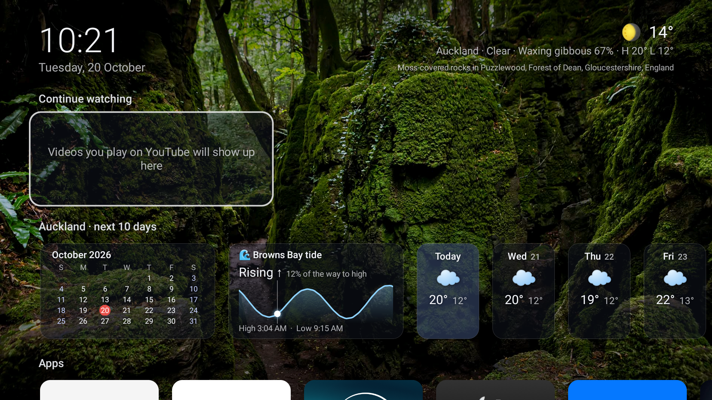
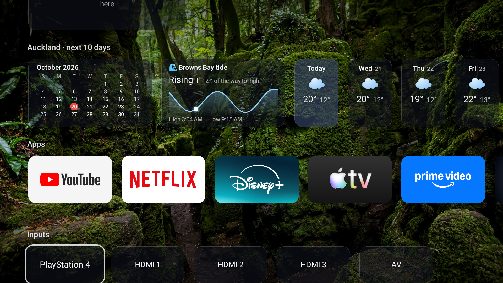

# TV Home

A calm, ad-free home screen for **Android TV / Google TV**, styled after Apple TV.




- **Continue watching:** the last YouTube videos played on the TV. Select one to resume where you
  stopped. Works whether you're signed in or watching as a guest.
- **Weather:** current conditions plus a 10-day forecast ([Open-Meteo](https://open-meteo.com), no
  API key). On clear nights it shows the real **moon phase**, mirrored in the southern hemisphere.
- **Tide:** time until the next high or low tide, the next turns, and a 24-hour curve for a spot you choose.
- **Calendar:** the current month, with weeks starting on your locale's first day.
- **Photo backgrounds:** a new landscape every 15 minutes, with its location
  ([Bing image archive](https://www.bing.com)).
- **Screensaver:** the same photos full screen with a slow drift, a large clock and dimmed
  brightness. It replaces the stock screensaver, which on some TVs is a rainbow gradient or ads.
- **Apps** in the order you choose, and **inputs** with HDMI-CEC device names (e.g. "PlayStation 4").
- English and Russian, following the system language or set separately.
- Plain Java on the Android framework, with no libraries and no Gradle. The APK is about 50 KB and
  uses roughly 65 MB of RAM, compared with about 160 MB for the stock Google TV launcher.
- No accounts, analytics or tracking. The only network calls are to Open-Meteo, Bing images and
  YouTube (thumbnails and video lookup).

Requires Android 8.0+ (API 26). Tested on Android TV 11 / Google TV (Skyworth-made JVC 4K TV).

## Install

**1. On the TV**, turn on debugging: **Settings > System > About**, press **Build** (or "Android TV
OS build") 7 times. Then go to **Settings > System > Developer options** and switch on **USB
debugging** (and **Network debugging**, if listed). Note the TV's IP address in **Settings > Network**.

**2. On your computer**, with `adb` installed (`brew install --cask android-platform-tools`,
`apt install adb`, or the Android SDK):

```sh
git clone https://github.com/dknz-maker/tv-home.git && cd tv-home
./install.sh 192.168.1.50                    # your TV's IP
```

The TV asks **"Allow USB debugging?"**: tick *Always allow* and press OK. The script downloads the
latest release (or uses your own build), installs it, lets it read YouTube's "now playing" info,
makes it the home screen and sets it as the screensaver.

**Google TV:** the stock launcher outranks third-party home screens, so the script tells you if the
Home button still opens it. Then run:

```sh
./install.sh 192.168.1.50 --replace-stock    # disables the stock launcher (reversible)
./install.sh 192.168.1.50 --restore-stock    # undo: re-enable it and switch back
```

`--replace-stock` uses `pm disable-user`: nothing is uninstalled, and `--restore-stock` puts it back.

Prefer to install by hand? Download `tv-home.apk` from
[Releases](https://github.com/dknz-maker/tv-home/releases), then:

```sh
adb install -r tv-home.apk
adb shell cmd notification allow_listener nz.home.tv/nz.home.tv.MediaListener
adb shell cmd package set-home-activity nz.home.tv/.MainActivity
adb shell settings put secure screensaver_components nz.home.tv/.PhotoDream   # optional
```

## Configure

Settings are changed over adb. The home screen refreshes with the new values:

```sh
adb shell am broadcast -a nz.home.tv.CONFIG -n nz.home.tv/.ConfigReceiver \
    --es city "London" --es lat 51.5072 --es lon -0.1276 --es tide off
```

| Key | Default | Meaning |
|---|---|---|
| `city` | `Auckland` | Name shown with the weather |
| `lat`, `lon` | `-36.8485`, `174.7633` | Weather location |
| `units` | `celsius` | `celsius` or `fahrenheit` |
| `tide` | `Browns Bay` | Tide spot name, or `off` to hide the tide card |
| `tide_lat`, `tide_lon` | `-36.7166`, `174.75` | Tide location; pick a point just offshore |
| `lang` | system | `en`, `ru`, or empty for the system language |
| `order` | popular apps | Comma-separated package names shown first in the Apps row |
| `hide` | none | Comma-separated package names to hide |
| `captions` | `true` | Show the photo location |
| `market` | `en-US` | Bing market for photos |

`--ez reset true` restores all defaults. Package names: `adb shell pm list packages`.

Only the adb shell (or the system) can send this broadcast. The receiver requires
`android.permission.DUMP`, which normal apps can't hold.

## How it works

| | |
|---|---|
| Continue watching | A `NotificationListenerService` (no notifications are read) gets access to media sessions. When YouTube has played a video for 10 s, it saves the title, channel and artwork. YouTube doesn't expose the video ID, so the app looks it up once with a YouTube search for the title and channel. When playback pauses or stops, the position is saved so the card can resume with `&t=`. Everything stays on the TV, in the app's private storage. |
| Weather | Open-Meteo forecast API, refreshed every 30 minutes. |
| Tide | Open-Meteo marine API (`sea_level_height_msl`), hourly. Highs and lows are refined with a parabola fit. It's a model, not official tide tables: times are good, heights are smoothed, so the card shows the state and times rather than metres. |
| Moon | Calculated locally from the synodic month (reference new moon 2000-01-06). |
| Photos | Bing's daily image archive (about 15 photos), cached on disk. The photo changes on each quarter hour. |
| Screensaver | A `DreamService` that crossfades the cached photos every minute with a slow zoom and pan, dims the backlight (`setScreenBright(false)`) and shows the time, date and temperature. |

## Build from source

Needs the Android SDK (build-tools and any platform ≥ 30) and JDK 11+. No Gradle:

```sh
./build.sh            # -> build/tv-home.apk
./build.sh install    # build and adb install
```

Each machine signs with its own local key (`tv-home.keystore`, git-ignored). To switch between the
release APK and your own build, `adb uninstall nz.home.tv` first.

Code: `src/nz/home/tv/`. `MainActivity` is the UI, `History` and `MediaListener` handle continue
watching, `PhotoDream` is the screensaver, and `Tide`, `Wallpapers`, `Config` and `ConfigReceiver`
do what their names say. Strings live
in `res/values*/strings.xml`; to add a language, add `res/values-xx/strings.xml`.

## Optional: debloat the TV

[extras/DEBLOAT.md](extras/DEBLOAT.md) describes how I removed ads, telemetry and vendor services
from a JVC/Skyworth Google TV without root, which packages I kept and why, and how to undo it.

## Uninstall

```sh
./install.sh <tv-ip> --restore-stock
adb uninstall nz.home.tv
```

## License

MIT
